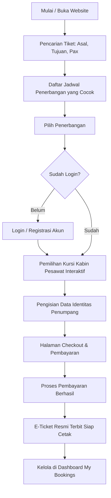

<div align="center">

# ✈️ TravelFly Enterprise Platform
### *Sistem Pemesanan Tiket Pesawat & Manajemen Maskapai Penerbangan Modern*

**Cepat • Nyaman • Terpercaya**

[](https://laravel.com)
[](https://php.net)
[](https://tailwindcss.com)
[](https://vitejs.dev)
[](https://mysql.com)
[](https://opensource.org/licenses/MIT)

<p align="center">
  Platform pemesanan tiket penerbangan daring (online flight ticket booking) dan pengelolaan operasional maskapai terpadu berbasis web yang modern, interaktif, responsif, dan siap produksi.
</p>

---

</div>

## 📌 Tentang Sistem (System Overview)

**TravelFly** adalah solusi digital enterprise terpadu yang dirancang untuk mempermudah calon penumpang dalam mencari jadwal penerbangan, membandingkan rute dan tarif maskapai, memilih kursi pesawat secara visual interaktif (*interactive airplane cabin seat map*), mengisi data manifes penumpang, hingga menyelesaikan pembayaran dan mencetak **E-Ticket** resmi.

Selain memudahkan pelanggan, TravelFly dilengkapi dengan **Panel Manajemen Admin** yang aman dan komprehensif. Admin dapat mengelola armada maskapai penerbangan, menyusun jadwal rute keberangkatan & kedatangan beserta harga kelas tiket (*Economy* & *Business*), serta memantau analitik transaksi pemesanan dan pembayaran secara langsung (*real-time*).

---

## ✨ Fitur-Fitur Utama (Key Features)

### 👨‍💼 Panel Manajemen Admin (`/admin`)
* **📊 Dashboard Analitik & Real-time Metrics**: Visualisasi statistik utama secara ringkas: total pengguna terdaftar, total jadwal penerbangan aktif, total transaksi pemesanan tiket (*Flight Bookings*), total omset pendapatan (*Revenue*), serta rekaman 5 transaksi pembayaran terbaru.
* **✈️ Manajemen Jadwal Penerbangan (Flight CRUD)**:
  * Pembuatan jadwal penerbangan lengkap: Maskapai (*Airline*), Nomor Penerbangan (*Flight Number*), Kota Asal (*Origin*), Kota Tujuan (*Destination*), Waktu Berangkat (*Departure*), dan Waktu Tiba (*Arrival*).
  * Pengaturan tarif tiket untuk kelas **Ekonomi** dan **Bisnis**.
  * **Otomatisasi Denah Kursi**: Sistem secara otomatis meng-generate denah kursi kabin pesawat (Baris 1–4 untuk *Business Class* dan Baris 5–14 untuk *Economy Class*) begitu penerbangan baru dibuat.
* **🏢 Manajemen Maskapai Penerbangan (Airlines CRUD)**: Pengelolaan maskapai mitra (Garuda Indonesia, Singapore Airlines, Qatar Airways, Citilink, Batik Air, dll.), kode IATA unik, serta fitur unggah dan pembaruan logo maskapai.
* **📋 Monitoring Pemesanan Tiket (Flight Bookings)**: Pemantauan terpusat seluruh daftar transaksi pemesanan pengguna, status tiket (`pending`, `paid`, `cancelled`), identitas penumpang, dan nomor kursi terkait.
* **💳 Monitoring Pembayaran (Payment Logs)**: Transparansi data pembayaran pengguna meliputi tanggal transaksi, metode pembayaran, total nominal, serta status verifikasi pembayaran.

---

### 👤 Panel Pengguna & Wisatawan (Customer / Traveler)
* **🔍 Pencarian Tiket & Destinasi Populer**:
  * Widget pencarian instan pada halaman beranda berdasarkan kota asal, kota tujuan, dan jumlah penumpang (*pax*).
  * Menampilkan etalase destinasi terpopuler beserta penawaran harga termurah secara dinamis.
* **💺 Visual Interactive Airplane Seat Picker**:
  * Denah kabin pesawat visual dua kelas (*Business Class* konfigurasi 2-2 & *Economy Class* konfigurasi 3-3).
  * Indikator status kursi real-time (*Tersedia*, *Terpilih*, dan *Sudah Dipesan / Sold Out*).
  * Validasi pemilihan jumlah kursi yang wajib cocok dengan kuota penumpang yang dimasukkan.
* **👥 Multi-Passenger Data Entry**: Formulir pengisian data identitas untuk setiap penumpang (Nama Lengkap & Nomor Identitas KTP / Paspor) yang dipetakan langsung ke kursi yang dipilih.
* **💳 Simulasi Checkout & Pembayaran Cepat**:
  * Kalkulasi total biaya penerbangan otomatis berdasarkan kelas kursi yang dipilih.
  * Halaman checkout aman dengan berbagai opsi metode pembayaran (Transfer Bank, Kartu Kredit, E-Wallet).
* **🎟️ E-Ticket Digital Siap Cetak (Print-Ready)**:
  * Penerbitan tiket elektronik resmi begitu pembayaran berhasil.
  * Dilengkapi kode booking unik (`#FB-XXXXX`), rincian rute, logo maskapai, waktu terbang, manifes penumpang, serta barcode siap cetak langsung dari browser (*Ctrl + P* / Print Preview).
* **📑 Dashboard Pesanan Saya (My Bookings)**:
  * Pantau semua riwayat tiket penerbangan yang pernah dipesan.
  * Lihat detail pemesanan dan cetak ulang E-Ticket kapan saja.
  * **Fitur Pembatalan Tiket (Cancel Booking)**: Pembatalan pesanan yang secara otomatis mengembalikan status kursi menjadi kosong kembali (*available*).
* **🔐 Otentikasi & Keamanan Pengguna**:
  * Registrasi akun baru, Login, dan Logout berbasis sesi aman.
  * Proteksi hak akses bertingkat melalui middleware khusus (*Customer* vs *Administrator*).

---

## 🗺️ Alur Penggunaan Aplikasi (Application Workflow)



---

## 🛠️ Arsitektur & Teknologi (Tech Stack)

| Komponen | Teknologi | Keterangan |
| :--- | :--- | :--- |
| **Backend Framework** | [Laravel 12.x](https://laravel.com/) | Framework PHP modern berbasis arsitektur MVC |
| **Bahasa Pemrograman** | [PHP 8.2+](https://php.net/) / PHP 8.3 | Minimum requirement PHP ^8.2 |
| **Database Server** | MySQL / MariaDB | Relational Database Management System |
| **Frontend Templating** | Blade Templating | Template engine bawaan Laravel |
| **Styling & CSS** | Tailwind CSS v4 & Custom CSS | Antarmuka responsif dan estetik |
| **Build Tool & Bundler** | [Vite 7.x](https://vitejs.dev/) | High-performance frontend bundler |
| **Autentikasi & Otorisasi**| Session Auth & Custom Middleware | Middleware `AdminMiddleware` untuk memproteksi area admin |
| **Manajemen Berkas** | Laravel Filesystem Storage | Pengelolaan media logo maskapai via storage symlink |
| **Version Control** | Git & GitHub | Pelacakan dan kolaborasi kode sumber |

---

## 📁 Struktur Direktori Project (Directory Structure)

```text
travelfly/
├── app/
│   ├── Http/
│   │   ├── Controllers/
│   │   │   ├── Admin/                  # Controller operasional Admin
│   │   │   │   ├── AirlineController.php     # Kelola data maskapai & logo
│   │   │   │   ├── BookingController.php     # Monitoring pemesanan tiket
│   │   │   │   ├── DashboardController.php   # Metrik analitik & ringkasan
│   │   │   │   ├── FlightController.php      # Kelola jadwal & auto-generate kursi
│   │   │   │   └── PaymentController.php     # Monitoring riwayat pembayaran
│   │   │   ├── Auth/
│   │   │   │   └── AuthController.php        # Login, Register, & Logout
│   │   │   ├── FlightBookingController.php   # Pemesanan kursi, pembatalan, & riwayat
│   │   │   ├── FlightController.php          # Katalog & pencarian penerbangan
│   │   │   ├── PaymentController.php         # Checkout & simulasi pembayaran
│   │   │   └── TicketController.php          # Penerbitan & pencetakan E-Ticket
│   │   └── Middleware/
│   │       └── AdminMiddleware.php           # Proteksi hak akses administrator
│   └── Models/                               # Eloquent Models
│       ├── Airline.php
│       ├── Flight.php
│       ├── FlightBooking.php
│       ├── FlightPassenger.php
│       ├── Payment.php
│       ├── Seat.php
│       └── User.php
├── database/
│   ├── migrations/                           # Skema struktur tabel database
│   └── seeders/                              # Data awal pengguna, maskapai, & jadwal dummy
│       ├── DatabaseSeeder.php
│       └── FlightDummySeeder.php
├── public/
│   ├── images/                               # Aset grafis & logo maskapai (GA, SQ, EK, dll.)
│   └── storage/                              # Symbolic link ke berkas upload
├── resources/
│   ├── css/                                  # Styling aplikasi & stylesheet admin
│   └── views/                                # Blade templates
│       ├── admin/                            # Tampilan panel dashboard & CRUD admin
│       ├── auth/                             # Halaman login & registrasi
│       ├── flights/                          # Halaman pencarian & denah kursi interaktif
│       ├── layouts/                          # Master layout (app & admin)
│       ├── payments/                         # Halaman checkout & pembayaran
│       ├── tickets/                          # Template cetak E-Ticket digital
│       ├── user/                             # Halaman "My Bookings" & detail pesanan
│       └── home.blade.php                    # Landing page utama TravelFly
└── routes/
    ├── admin.php                             # Rute khusus panel admin (/admin/*)
    └── web.php                               # Rute publik & rute pelanggan
```

---

## 🚀 Panduan Instalasi & Menjalankan (Getting Started)

Ikuti langkah-langkah di bawah ini untuk menjalankan project TravelFly pada lingkungan lokal Anda:

### 1. Prasyarat Sistem
Pastikan perangkat Anda telah terpasang:
* **PHP** >= 8.2 (Direkomendasikan PHP 8.2 atau 8.3)
* **Composer** >= 2.x
* **Node.js** (LTS) & **NPM**
* **MySQL Server** (melalui Laragon, XAMPP, atau instalasi mandiri)
* **Git**

---

### 2. Langkah-Langkah Instalasi

#### Langkah 1: Clone Repository
Buka terminal atau command prompt, lalu clone repository ini:
```bash
git clone https://github.com/username/travelfly.git
cd travelfly
```
*(Ganti URL di atas dengan link repository GitHub Anda)*

#### Langkah 2: Install Dependensi Backend (Composer)
```bash
composer install
```

#### Langkah 3: Install Dependensi Frontend (NPM)
```bash
npm install
```

#### Langkah 4: Konfigurasi File Environment
Salin file `.env.example` menjadi `.env`:
```bash
# Windows Command Prompt / PowerShell:
copy .env.example .env

# Bash / Git Bash:
cp .env.example .env
```

#### Langkah 5: Generate Application Key
```bash
php artisan key:generate
```

#### Langkah 6: Konfigurasi Database
Buka file `.env` pada text editor favorit Anda, lalu sesuaikan koneksi database MySQL:
```env
DB_CONNECTION=mysql
DB_HOST=127.0.0.1
DB_PORT=3306
DB_DATABASE=travelfly
DB_USERNAME=root
DB_PASSWORD=
```
> **Catatan**: Pastikan database dengan nama `travelfly` sudah dibuat di MySQL (misal via phpMyAdmin atau HeidiSQL).

#### Langkah 7: Jalankan Migrasi & Database Seeder
Jalankan migrasi untuk membuat tabel, sekaligus mengisi data awal akun demo, daftar maskapai, serta jadwal penerbangan dummy:
```bash
# Migrasi dan seeding akun dasar serta maskapai:
php artisan migrate --seed

# (Opsional) Jalankan seeder dummy untuk jadwal rute penerbangan & kursi:
php artisan db:seed --class=FlightDummySeeder
```

#### Langkah 8: Hubungkan Storage (Symbolic Link)
Buat symlink dari storage ke folder publik untuk mendukung unggahan berkas logo maskapai:
```bash
php artisan storage:link
```

#### Langkah 9: Jalankan Server Development & Asset Compiler
Buka dua jendela terminal terpisah (atau gunakan satu terminal jika menggunakan background process):

**Terminal 1 (PHP Server):**
```bash
php artisan serve
```

**Terminal 2 (Vite Asset Compiler):**
```bash
npm run dev
```

Aplikasi kini siap diakses melalui peramban web pada alamat:
👉 **[http://127.0.0.1:8000](http://127.0.0.1:8000)**

---

## 🔑 Akun Akses Demo (Default Credentials)

Setelah menjalankan `php artisan migrate --seed`, Anda dapat langsung menggunakan akun bawaan berikut untuk mencoba sistem:

| Peran (Role) | Email | Password | Akses URL & Keterangan |
| :--- | :--- | :--- | :--- |
| **Administrator** | `admin@travelfly.com` | `password` | Masuk melalui `/login`, otomatis diarahkan ke Panel Admin (`/admin`) |
| **Customer / User** | `user@example.com` | `password` | Masuk melalui `/login`, diarahkan ke halaman pemesanan tiket |

> Anda juga dapat mendaftarkan akun baru secara mandiri melalui menu **Daftar / Register**.

---

## 📖 Panduan Penggunaan Aplikasi (How to Use)

### 🧑‍💻 Sebagai Pengguna / Penumpang:
1. **Buka Halaman Utama**: Akses `http://127.0.0.1:8000`.
2. **Cari Penerbangan**: Tentukan kota asal (misal: *Jakarta*), kota tujuan (misal: *Bali*), serta jumlah penumpang (*pax*), lalu klik **Cari Tiket**.
3. **Pilih Tiket Penerbangan**: Lihat daftar maskapai dan jam terbang yang tersedia, kemudian klik **Pilih Penerbangan**.
4. **Pilih Kursi Pesawat**: Pada tampilan layout kabin pesawat interaktif, pilih kursi favorit Anda (*Business* atau *Economy*).
5. **Isi Manifes Penumpang**: Masukkan nama lengkap dan nomor KTP/Paspor untuk tiap kursi.
6. **Checkout & Bayar**: Masuk ke halaman pembayaran, tentukan metode bayar yang diinginkan, lalu konfirmasi pembayaran.
7. **Cetak E-Ticket**: Setelah pembayaran berhasil, Anda akan diarahkan ke tiket elektronik. Klik tombol **Print E-Ticket** untuk mencetak atau menyimpannya sebagai file PDF.
8. **Kelola Riwayat**: Buka menu **Pesanan Saya (My Bookings)** untuk meninjau status pemesanan atau membatalkan tiket jika diperlukan.

### 🛡️ Sebagai Administrator:
1. **Login**: Masuk dengan akun `admin@travelfly.com`.
2. **Dashboard**: Pantau metrik total tiket terjual, statistik armada penerbangan, serta omset pendapatan.
3. **Kelola Maskapai**: Tambah atau perbarui data maskapai dan unggah logo maskapai pada menu **Airlines**.
4. **Kelola Penerbangan**: Buat jadwal penerbangan baru pada menu **Flights**. Denah kursi pesawat akan digenerate secara otomatis oleh sistem.
5. **Pantau Bookings & Payments**: Periksa riwayat transaksi seluruh pelanggan pada menu **Bookings** dan log pembayaran pada menu **Payments**.

---

## 📤 Cara Update Perubahan ke GitHub (Push to GitHub)

Jika Anda melakukan perubahan kode atau ingin mengunggah README ini ke repository GitHub Anda, jalankan perintah Git berikut pada terminal:

```bash
# 1. Tambahkan semua perubahan file
git add README.md

# 2. Buat commit pesan deskriptif
git commit -m "docs: update README with TravelFly flight booking enterprise guide"

# 3. Kirim perubahan ke branch utama GitHub
git push origin main
```

---

## 📄 Lisensi (License)

Project ini dikembangkan sebagai platform terbuka di bawah lisensi [MIT License](https://opensource.org/licenses/MIT). Anda bebas menggunakan, memodifikasi, dan mendistribusikan kode ini untuk keperluan edukasi maupun komersial.

<div align="center">
  <sub>TravelFly Enterprise © 2026. Dibuat dengan dedikasi untuk menghadirkan pengalaman pemesanan tiket penerbangan terbaik.</sub>
</div>
"# travelfly" 
